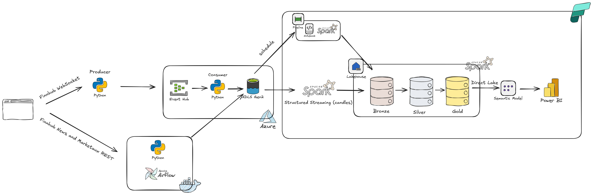
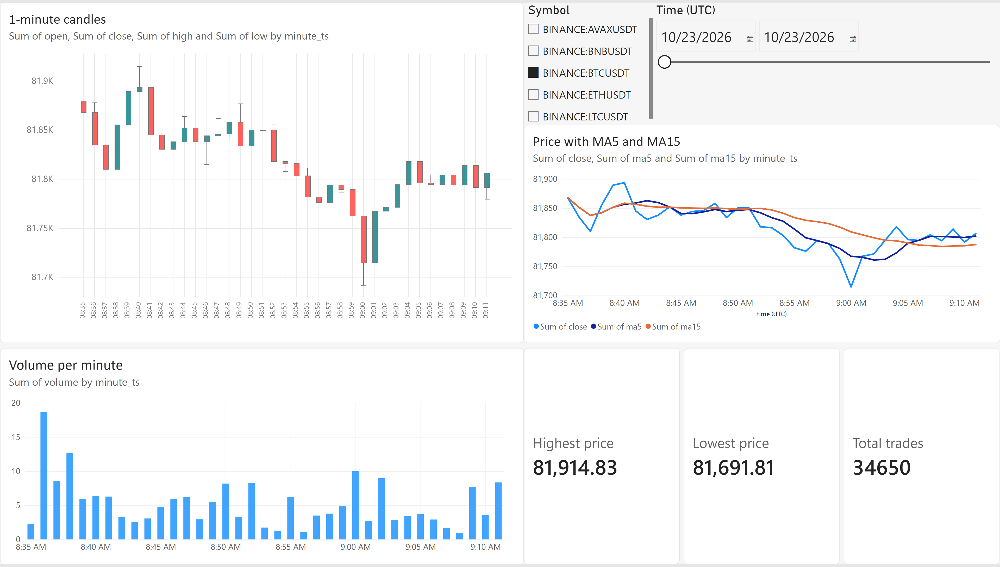
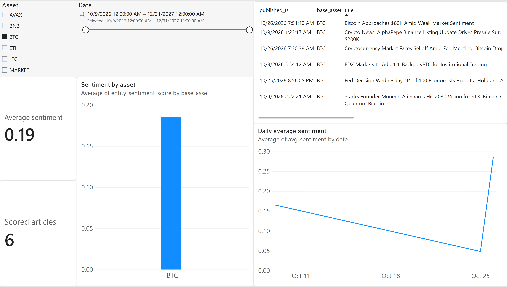
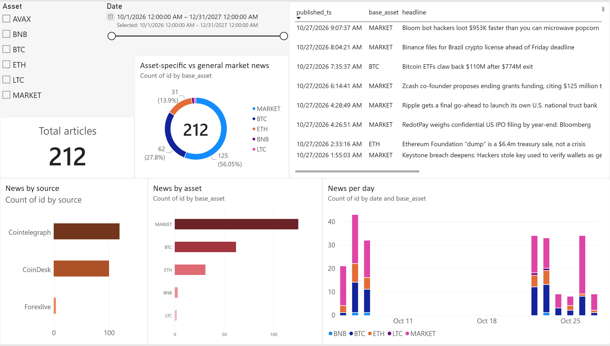

# Crypto Market Data Engineering Pipeline

End-to-end data engineering project: real-time crypto market data from Finnhub is streamed through Azure Event Hubs into a medallion lakehouse on Microsoft Fabric. News and sentiment are ingested by Airflow, and everything is served through a Power BI (Direct Lake) dashboard.

## Highlights

- **Real-time ingestion:** Finnhub WebSocket trade ticks aggregated into 1-minute OHLCV candles (event time, late-tick grace period) and published to Azure Event Hubs.
- **Streaming to lake:** an asyncio consumer buffers candles and flushes them in batches to ADLS Gen2, avoiding the small-files problem.
- **Medallion lakehouse:** bronze, silver and gold Delta tables in a Fabric Lakehouse, built with Spark Structured Streaming and Delta `MERGE`.
- **Orchestrated batch sources:** Airflow DAGs ingest crypto news (hourly) and sentiment scores (daily).
- **Data quality:** idempotent upserts, quarantine tables for invalid rows, and validity flags on OHLC data.
- **Serving:** Power BI semantic model in Direct Lake mode with a three-page report.

## Architecture



### Data flow

| Stage           | What happens                                                                                                                                                                  |
| --------------- | ----------------------------------------------------------------------------------------------------------------------------------------------------------------------------- |
| Producer        | `finnhub_crypto_producer.py` subscribes to Finnhub trades, builds 1-minute candles per symbol and sends them to Event Hubs (one fixed partition per symbol).                  |
| Consumer        | `eventhub_to_lake_consumer.py` reads Event Hubs with checkpoints in Blob Storage, buffers candles and writes JSONL files to the ADLS Gen2 `source` container every 5 minutes. |
| Airflow         | DAGs call Finnhub news (hourly) and Marketaux sentiment (daily) and upload JSONL files to the same `source` container.                                                        |
| Fabric shortcut | The Lakehouse exposes the ADLS `source` container through a shortcut (no copy).                                                                                               |
| Bronze          | Raw data as Delta tables, plus ingestion timestamp and source-file lineage columns. Duplicates are kept.                                                                      |
| Silver          | Cleaned, typed and deduplicated data. Rows missing critical fields go to quarantine tables.                                                                                   |
| Gold            | Feature tables, daily aggregates, news and sentiment by asset, and dimensions.                                                                                                |
| Power BI        | Direct Lake semantic model and report on top of gold.                                                                                                                         |

Candles run as a continuous streaming job. News and sentiment run through scheduled Fabric pipelines using `trigger(availableNow=True)`; Spark checkpoints track which files were already processed.

## Tech stack

| Layer         | Tools                                                        |
| ------------- | ------------------------------------------------------------ |
| Sources       | Finnhub (WebSocket and REST), Marketaux (REST)               |
| Messaging     | Azure Event Hubs, Azure Blob Storage (checkpoints)           |
| Orchestration | Apache Airflow (Docker), Fabric Data Pipelines               |
| Storage       | ADLS Gen2 (landing), Fabric Lakehouse / OneLake (Delta Lake) |
| Processing    | PySpark, Spark Structured Streaming, Delta `MERGE`           |
| Serving       | Power BI semantic model (Direct Lake)                        |
| Tooling       | Python, uv, Docker, Git (Fabric Git integration)             |

## Repository structure

```
.
├── airflow/                      # Airflow (Docker): news and sentiment ingestion DAGs
├── fabric/                       # Fabric workspace items synced via Git (notebooks, pipelines, semantic model, report)
├── plugins/                      # Airflow plugins
├── src/crypto_pipeline/
│   ├── ingestion/
│   │   └── finnhub_crypto_producer.py     # Finnhub WebSocket -> 1-min candles -> Event Hubs
│   └── streaming/
│       └── eventhub_to_lake_consumer.py   # Event Hubs -> buffered JSONL -> ADLS Gen2
├── .env.example                  # Required environment variables (no secrets)
├── pyproject.toml
├── uv.lock
├── requirements.txt
└── README.md
```

## Data model

Tracked symbols: BTC, ETH, BNB, AVAX, LTC (Binance USDT pairs).

| Layer  | Tables                                                                                                                                                                                      |
| ------ | ------------------------------------------------------------------------------------------------------------------------------------------------------------------------------------------- |
| Bronze | `bronze.candles`, `bronze.news`, `bronze.sentiment`, plus `*_quarantine` tables                                                                                                             |
| Silver | `silver.candles`, `silver.news`, `silver.sentiment`                                                                                                                                         |
| Gold   | `gold.ohlcv_1m_features`, `gold.ohlcv_1m_features_history`, `gold.ohlcv_daily`, `gold.news_by_symbol`, `gold.sentiment_articles`, `gold.sentiment_daily`, `gold.dim_asset`, `gold.dim_date` |

- `ohlcv_1m_features`: 1-minute candles with return, MA5, MA15, 5-period volatility and typical price.
- `ohlcv_1m_features_history`: append-only snapshots of features.
- `news_by_symbol`: one row per article and asset; general market news is tagged `MARKET`.
- `dim_asset` and `dim_date` are the conformed dimensions of the semantic model.

## Dashboard

**Market overview:** candlestick chart, price with MA5 and MA15, volume per minute and summary cards.



**Sentiment:** average sentiment by day and by asset, article counts and latest scored articles.



**News:** news volume by day, asset and source, plus the latest headlines with links.



## Getting started

### Prerequisites

- Python (see `.python-version`) and [uv](https://docs.astral.sh/uv/)
- Docker (for Airflow)
- Finnhub API key and Marketaux API token
- Azure: Event Hubs namespace and event hub, Storage account with ADLS Gen2 (container `source`) and a Blob container for checkpoints
- Microsoft Fabric workspace with a Lakehouse

### Configuration

Copy `.env.example` to `.env` and fill in the values. Never commit `.env`.

| Variable                                                   | Purpose                                           |
| ---------------------------------------------------------- | ------------------------------------------------- |
| `FINNHUB_API_KEY`                                          | Finnhub WebSocket and news                        |
| `MARKETAUX_API_TOKEN`                                      | Sentiment source                                  |
| `EVENT_HUB_CONNECTION_STR_PRODUCER`                        | Event Hubs connection string used by the producer |
| `EVENT_HUB_CONNECTION_STR_CONSUMER`                        | Event Hubs connection string used by the consumer |
| `EVENT_HUB_NAME`                                           | Event hub for candles                             |
| `EH_CONSUMER_GROUP`                                        | Consumer group for the lake consumer              |
| `BLOB_STORAGE_CONNECTION_STRING`, `CHECKPOINT_CONTAINER`   | Consumer checkpoints                              |
| `ADLS_ACCOUNT_NAME`, `ADLS_ACCOUNT_KEY`, `ADLS_FILESYSTEM` | ADLS Gen2 landing zone                            |

Airflow reads ADLS credentials from an Airflow connection named `adls2_connection`.

### Run the streaming ingestion

```bash
uv sync
uv run python src/crypto_pipeline/ingestion/finnhub_crypto_producer.py
uv run python src/crypto_pipeline/streaming/eventhub_to_lake_consumer.py
```

### Run Airflow

<!-- TODO: confirm the path of the compose file -->

```bash
cd airflow
docker compose up -d
```

Then create the `adls2_connection` connection and enable the news and sentiment DAGs.

### Set up Fabric

1. Create a Lakehouse with `bronze`, `silver` and `gold` schemas.
2. Create a shortcut to the ADLS `source` container.
3. Import the notebooks from `fabric/` (or connect the workspace to this repo).
4. Create the scheduled pipelines: news (hourly), sentiment (daily) and gold candles.
5. Run the candles streaming notebook (long-running).
6. Create the Direct Lake semantic model and the Power BI report.

## Design decisions

- **Event-time candles:** candles are grouped by trade timestamp with a short grace period for late ticks, and one fixed partition per symbol preserves per-symbol ordering.
- **Buffer and flush:** the consumer writes one file per flush interval instead of one file per candle.
- **At-least-once delivery, idempotent writes:** duplicates are expected, so silver uses `MERGE` on `(symbol, minute_ms, interval)` and similar keys for news and sentiment.
- **Raw bronze, strict silver:** bronze keeps everything. Silver handles nulls, types and duplicates. Invalid rows go to quarantine tables instead of being dropped silently, and an OHLC validity flag is kept for audit.
- **Right run mode per source:** continuous streaming for candles, scheduled `availableNow` runs for news and sentiment.
- **Streaming-first medallion:** a single processing path, so the design is closer to a Kappa architecture than a classic Lambda architecture.
- **Sentiment source:** Marketaux replaced Alpha Vantage after the Alpha Vantage news sentiment endpoint became premium.

## Known limitations

- The producer and consumer run on a local machine, so data is intermittent and candle series contain gaps. Rolling features restart after each gap.
- Free-tier limits: some symbols stream no ticks on Finnhub, and Marketaux returns only a few articles per call, so sentiment is sparse.
- News symbols are tagged by keyword matching, so a share of articles is labelled `MARKET`.
- Dashboard candles are built from Finnhub trade ticks and can differ slightly from official exchange candles.
- Price visuals assume a single asset is selected in the slicer.

## Roadmap

- RAG question answering over news (vector search) and gold tables (text-to-SQL).
- Historical backfill from exchange klines for continuous series.
- Price prediction model, once continuous history is available.

## Author

### Ngô Tuấn Tú, [LinkedIn](linkedin.com/in/ngo-tuan-tu)
